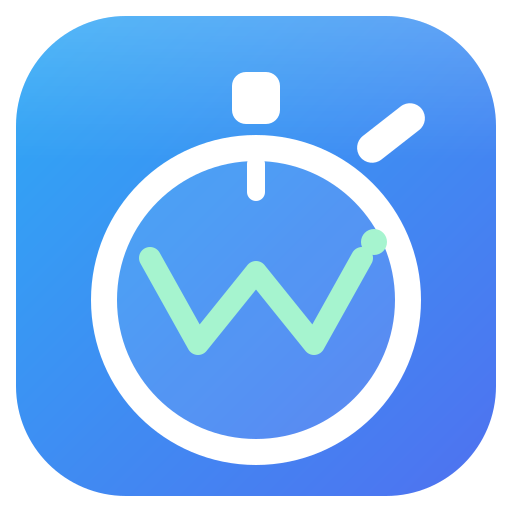
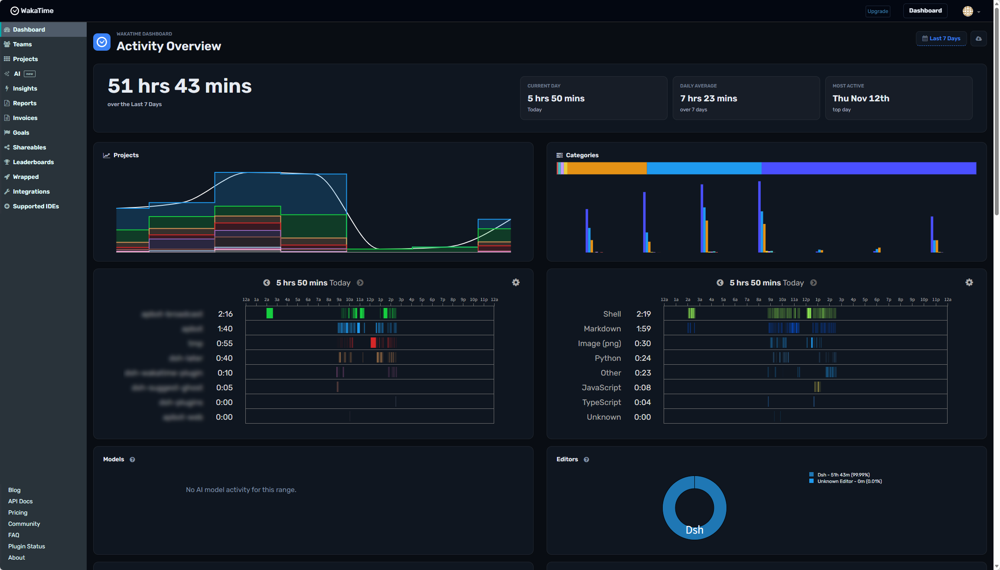

<div align="center">



# dsh-wakatime — WakaTime heartbeats for DSH

[中文](./README.md) | **English**

[](https://github.com/dsh-plugin-collection/dsh-wakatime)
[](LICENSE)
[](https://github.com/deepseek-ai/deepseek-harness)

</div>

---

## What this is

Activity inside DSH never reaches WakaTime on its own: [WakaTime](https://wakatime.com) is fed by editor plugins, while your work here happens in a terminal and in AI conversations. This plugin bridges that gap — it listens to DSH events and turns them into WakaTime heartbeats.

- a `write` / `edit` → one heartbeat with line counts and language
- a `bash` command → one `app` heartbeat whose category comes from the command itself
- an AI turn → one `ai coding` heartbeat carrying token usage

What it does not do: patch DSH internals, bundle host components, or store anything beyond the local retry cache.

## Preview

The WakaTime dashboard after installing:

<p align="center">
  
</p>

All four panels are fed by this plugin:

| Panel | Source |
|---|---|
| **Projects** | Each heartbeat's `project`, inferred from git / `package.json` / directory name |
| **Categories** | Tool → category mapping (see [Category mapping](#category-mapping)) |
| **Languages** | Inferred from file extensions |
| **Editors** | Derived from the heartbeat `User-Agent` (`dsh/1.0.0 dsh-wakatime/1.0.0`), which is why "working in DSH" shows up as its own editor |

## Install

```bash
dsh plugin --profile web add dsh-wakatime
```

**Restart `dsh web`** afterwards. Then open **Settings → WakaTime** and paste your [API key](https://wakatime.com/settings/api-key).

<details>
<summary>Other install methods</summary>

From GitHub:

```bash
dsh plugin --profile web add github:dsh-plugin-collection/dsh-wakatime
```

Local development (from the plugin directory):

```bash
dsh plugin --profile web add /path/to/dsh-wakatime
```

From source:

```bash
cd dsh-wakatime && pnpm install && pnpm build
```

Internal distribution: also mirrored on a private Gitea for internal use — ask the maintainer for the URL and pin a commit:

```bash
dsh plugin --profile web add <internal-repo-url>#<commit-sha>
```
</details>

## Configuration

Everything lives in **Settings → WakaTime** and takes effect on save — no restart.

| Setting | Description |
|---|---|
| **API Key** | WakaTime API key (masked input). When empty it falls back to `WAKATIME_API_KEY`, then `~/.wakatime.cfg`, then `cordis.patch.yml` |
| **API URL** | Service endpoint, default `https://wakatime.com`; set your own for a self-hosted [WakaTime](https://wakatime.com) |
| **Proxy URL** | `http://host:port`. Empty falls back to `HTTPS_PROXY`, then `proxy` in `~/.wakatime.cfg`; `none` forces a direct connection |
| **No-proxy hosts** | Comma separated, empty inherits `NO_PROXY`. e.g. `wakatime.com` connects that host directly |
| **Heartbeat interval** | 60000–300000 ms |
| **Project name / Language** | Empty = auto-detect; a value overrides it |
| **Terminal app name** | The entity for command heartbeats, default `Terminal`; set it to e.g. `DSH` |
| **Track switches ×3** | Tool calls / user messages / AI messages |
| **Cache** | Enable local cache + limit (10–1000 entries) |
| **Debug mode** | More verbose logging |

**API key precedence**: settings page → `WAKATIME_API_KEY` → `cordis.patch.yml` → `~/.wakatime.cfg`. Every layer only accepts a non-empty string; a malformed value is skipped with a warning and resolution continues.

## Verify

Four steps to confirm it works:

1. **Check the log** — after restart you should see `loaded with API key waka_****xxxx`;
2. **Make DSH do something** — read a file, run a command;
3. **Wait one heartbeat cycle** (120 s by default) until a flush succeeds;
4. **Open the [WakaTime dashboard](https://wakatime.com/dashboard)** — today's time, projects and languages should show the activity.

If step 3 stays quiet, check the local cache first:

```bash
wc -l ~/.dsh/wakatime/heartbeat-cache.jsonl
```

- `0` lines or no file = healthy (the cache is only written on failure);
- **growing** = sends are failing — look for `上报失败…` in the log.

## Compatibility

| Side | Notes |
|---|---|
| **DSH** | Supported range is `engines.dsh` in `package.json`; currently covers generations `0.1.2` – `0.2.3` (prereleases included). The host validates it at startup and disables the plugin on a mismatch |
| **Node** | >= 22.19 (including 24+) |
| **Platform** | Windows / macOS / Linux |
| **WakaTime** | [wakatime.com](https://wakatime.com), or any WakaTime-compatible self-hosted server |
| **Other telemetry plugins** | One heartbeat backend per profile — do not run codetime or similar alongside |

## Category mapping

| DSH tool | WakaTime category | is_write |
|---|---|---|
| `write` / `edit` | `coding` | ✅ |
| `read` / `grep` / `glob` | `browsing` | — |
| `bash` / `pwsh` | **Derived from the command** (below) | — |
| `web_search` | `researching` | — |
| `mcp__codegraph__codegraph_explore` | `code reviewing` | — |
| `mcp__langfuse__*` | `debugging` | — |
| `subagent` / `subagent_fork` / `workflow` / `todo_write` | `coding` | — |
| `ask_user_question` / user messages | `communicating` | — |
| AI replies | `ai coding` | — |
| `skill` | `learning` | — |
| Anything else | `coding` | — |

**Shell categories** are no longer a blanket `building` — an earlier implementation did that, and replaying 5290 shell heartbeats from a real account showed 98.7% of the reported "build time" was not building. Categories now come from the command:

| Command | Category |
|---|---|
| `ls` / `cat` / `grep` / `sed` / `head` … | `browsing` |
| `git` / `pnpm build` / `docker build` … | `coding` / `building` |
| `pnpm test` / `vitest` | `running tests` |
| Unrecognised | `coding` |

Only the **bare subcommand** is examined, never trailing arguments (`test` inside `grep -n foo test/a.py` does not count as a test run), and wrappers like `cd … &&`, `sudo` and `npx` are stripped first.

## Known limitations

- **File-level granularity** — DSH tool calls carry no cursor position, so line-level detail is coarser than an IDE plugin provides;
- **AI token accounting differs from IDE plugins**: the host reports uncached and cache-hit input as disjoint components, and the plugin sends them as separate fields, so the numbers are not directly comparable;
- **No historical backfill** — changing `entity` / `category` shape breaks cross-version comparisons on those dimensions;
- **Read endpoints are closed** to plugin keys (see [Development](#development)), so the plugin cannot read its own data back for validation.

## Development

<details>
<summary>Build, test and layout</summary>

```bash
pnpm install
pnpm build        # clears lib/ then rebuilds host + client
pnpm typecheck
pnpm test         # vitest, 169 cases
```

```
src/
├── index.ts         # entry: event listeners, timers, config migration
├── config-value.ts  # volatile-ref unwrapping and per-field validation
├── wakatime.ts      # HTTP client: proxy, bulk upload, per-item parsing
├── tracker.ts       # event → heartbeat conversion and merging
├── cache.ts         # local JSONL cache with time-based trimming
├── project.ts       # git / package.json project inference
├── category.ts      # shell command → category
├── language.ts      # extension → language
├── diff.ts          # write/edit line counts
└── types.ts         # types and constants
```
</details>

<details>
<summary>Bulk contract: outer 2xx + per-item statuses</summary>

The `heartbeats.bulk` response is **always 202 at the outer level**; real results live in per-item status codes inside `responses`. An implementation that only checks `response.ok` reads a fully rejected batch as a full success — rejected heartbeats neither enter the cache nor raise an error, which is plain data loss.

| Per-item status | Handling |
|---|---|
| `2xx` | Stored |
| `4xx` (except 429) | Permanent failure — dropped with a warning carrying the server's reason |
| `429` / `5xx` | Back to cache for retry |

String fields are pre-trimmed to the server's hard limits: `entity` ≤ 2083, `project` / `branch` ≤ 1024; an empty string is rejected too. A trimmed `entity` ends with `...`.
</details>

<details>
<summary>Cache policy</summary>

- Written **only on failure**, drained on success;
- Concurrent flushes are serialised, and only heartbeats that **truly did not land** are written back (an earlier version wrote stored ones back too, causing duplicates);
- Over the limit, the oldest are trimmed **by time** with a warning `缓存超过上限（N 条），最旧的 M 条心跳已被丢弃（from → to）` — that line means data is genuinely being lost.
</details>

<details>
<summary>AI token accounting</summary>

The host's `TokenUsage` input components are **disjoint**: `inputTokens` is the uncached part only, cache hits are reported separately in `cacheReadTokens`, and billed input is the sum of the three.

This plugin sends the uncached part as `ai_input_tokens` and cache hits as `ai_cached_input_tokens`, and **never adds them together**; `cacheWriteTokens` has no WakaTime counterpart and is not reported.

Measured sample: one session billed 80.1M input of which 78.7M (98%+) was cache hits. Reporting only the uncached part makes WakaTime's Tokens two orders of magnitude smaller than a local dashboard.
</details>

<details>
<summary>Version gate and peer ranges</summary>

The host's `evaluatePluginCompatibility` reads only the plugin's `package.json`:

| Condition | Behaviour |
|---|---|
| `engines.dsh` present | **Only that range is compared**; `peerDependencies` are ignored |
| Absent | Every `@deepseek-ai/dsh*` peer must be satisfied by the running version |
| Comparison | `semver.satisfies(running, range, { includePrerelease: true })` |
| Failure | Logs `Plugin … is incompatible with dsh …` and disables the row |

**Write peers as an explicit range list, not `^` prefixes, and never exact versions.** Under node-semver's default semantics (no `includePrerelease`) a prerelease range only matches when a comparator carries an anchor for the same `[major.minor.patch]` tuple: `^0.2.1-rc.2` expands to `>=0.2.1-rc.2 <0.3.0-0`, whose anchors are `0.2.1` and `0.3.0` only — so `satisfies('0.2.2-rc.1', '^0.2.1-rc.2')` is **false** and the plugin gets disabled once the host moves to 0.2.2-rc.1. Spelling out `>=0.2.2-alpha.2 <0.2.3-0` is what covers it.

Host 0.2.1 packages pin their dsh peers exactly to one version; copying that makes a plugin disappear on the next rc — on this machine `webhook-runtime` and `webhook-github` vanished that way.

**Adding a peer entry is ongoing**: one entry only covers that generation's rc plus its stable release; the next generation needs another.
</details>

<details>
<summary>Four version-sensitive wiring points (still true on 0.2.2)</summary>

| Wiring point | Rule |
|---|---|
| WebUI slot `plugins.bundle.config` key | Is the **package name** — not the settings namespace and not the profile entry id; a mismatch means no settings card |
| `@deepseek-ai/dsh-client-ui-primitives` | Must stay **external**; bundling it duplicates the whole icon set |
| Automatic settings projection | Requires `.volatile()` on Config; projection lives in the host's `dsh-app-boot` |
| `.volatile()` fields arrive as **ref objects** | `apply()` receives `Object.freeze({ get })`, not values. They **must be unwrapped**, otherwise `api_url` produces an invalid URL, `heartbeat_interval_ms` becomes 1 ms, booleans stay truthy, string fields are dropped entirely and `cache_limit` never trims. Handled centrally in `src/config-value.ts` |
</details>

<details>
<summary>Shell category measurement</summary>

Replaying 5290 shell heartbeats from a real account:

| Category | Before | After |
|---|---|---|
| `building` | 100.0% | 1.3% |
| `coding` | — | 50.6% |
| `browsing` | — | 46.4% |
| `researching` | — | 0.8% |
| `running tests` | — | 0.5% |
| `debugging` | — | 0.3% |

Categories use only WakaTime's authoritative set (`wakatime-cli`, `pkg/heartbeat/category.go`): there is no `deployment` and no `testing` (the right value is `running tests`), and invented words do not aggregate in the dashboard.
</details>

<details>
<summary>The command heartbeat entity</summary>

`bash` / `pwsh` heartbeats have `type: app`. Per wakatime-cli's definition (*"AppType represents an app entity"*) the entity should be an **app name**, not a command line. Treating the whole command as the entity scattered 5281 shell heartbeats into **5158 distinct entities, 98.2% of them seen exactly once** — no aggregation value, and one keystroke away from the 2083-character limit and per-item 400s.

It now comes from the "Terminal app name" setting (default `Terminal`); what the command does is expressed by `category`. The merge key inside the 5-second window is `entity + category`, otherwise an `ls` would overwrite a `pnpm test` from four seconds earlier under the same app name.

User message / AI reply heartbeats **deliberately keep** `dsh-session-<id>` as the entity: its cardinality is bounded by the session count and it is the only dimension that drills down by session.
</details>

<details>
<summary>Proxy precedence</summary>

The outbound proxy is taken from **settings page → env vars → `~/.wakatime.cfg` → direct**, first match wins. A layer that is not a valid `http(s)` URL is **ignored with a warning** and resolution continues.

With debug on, startup logs a line `网络出口 经代理 http://…（来源：设置页）` that answers which route is actually in use. Credentials in a proxy URL are masked to `***:***` before logging.

`NO_PROXY` / "No-proxy hosts" accept `*`, exact hosts and `.suffix` entries (`example.com` also matches its subdomains).

Why the plugin must read the cfg: measured on the same machine, curl direct, curl via proxy and node direct were all 20/20 while the plugin intermittently got `fetch failed` — because it was the only link not going through the proxy that was already configured in `~/.wakatime.cfg`.
</details>

<details>
<summary>Read endpoints return 403</summary>

Since 2026-10 WakaTime answers read endpoints (`/users/current`, `/users/current/projects`, `/users/current/heartbeats`) with:

```
403 API Keys are only for plugins, use your personal oauth token
```

while the **write endpoint `heartbeats.bulk` still accepts plugin keys**. This is an upstream policy change, not an auth bug in this plugin.

One consequence: the "Project name" dropdown in settings depended on `/users/current/projects`, so it was permanently empty and has been removed — the field is free text now. Also, do not read that 403 as a dead key: judge the key by the write endpoint or by the failure warnings.
</details>

<details>
<summary>Troubleshooting</summary>

**Plugin not loaded**: does `lib/` exist? Run `pnpm build`. Any incompatibility line in the log?

**No settings card**: confirm the plugin is in the profile's bundles; fully restart `dsh web`; check the browser console.

**Heartbeats not sending**, in this order (an earlier version went silent for a full week):

1. **Cache before logs** — `~/.dsh/wakatime/heartbeat-cache.jsonl` is only written on failure. Persistent growth or pinning at the limit means sends are failing and older heartbeats are being pushed out; that activity is unrecoverable.
2. **Read the warnings; debug is not required** — failures always warn with a reason and are written to **both the logger and console** (this host's `ctx.logger` never reaches the stdout capture file, so logger-only means no log at all — the direct reason two silent outages went unnoticed). Key lines: `上报失败…`, `缓存超过上限…已被丢弃`, `N/M 条心跳被逐条拒绝并已丢弃…`, `cache flush failed…`.
3. **After a host upgrade, look for the "config field is not a usable value" warning** — a volatile ref used as a value fails silently in several ways (see the wiring points above).
4. **Confirm the key** — `未配置 WakaTime API Key` = no usable value in any layer; `WakaTime API Key 无效` = the server returned 401; `上报失败…（cause: …）` = transport. Diagnostics carry `cause` (`ECONNRESET` / `ETIMEDOUT` / `ENOTFOUND`…), not just `fetch failed`.
5. **Suspect you are not running your code? Check the build fingerprint** — `apply called; artifact mtime=… pid=…` answers which build this process loaded. Hot reload can leave an old fiber sending with old code; restart DSH fully when behaviour disagrees with the source.
6. **Payload length is hard-validated** — if "per-item rejection" warnings persist, some field is outside the trimming coverage; paste the server's reason from the warning into an issue.
</details>

## References

- [WakaTime API docs](https://wakatime.com/developers)
- [wakatime-cli](https://github.com/wakatime/wakatime-cli) — authoritative source for categories and field semantics

## License

MIT © wujue
