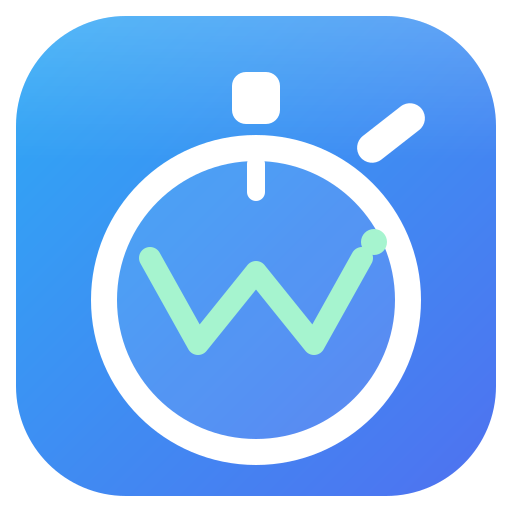

<p align="center">
  
</p>

# dsh-wakatime

[English](./README.md) | 简体中文

DeepSeek Harness（DSH）的 WakaTime 心跳上报插件。

追踪你的 AI 辅助编码活动，并同步到你的 [WakaTime](https://wakatime.com) 面板。

> **说明**：本项目为社区集成，与 WakaTime 官方无隶属关系。

## 功能特性

- **文件级追踪** —— 每次工具调用（write、edit、read、bash、grep、glob 等）都会生成一条精确的 WakaTime 心跳
- **智能项目识别** —— 自动从 git、package.json 或目录名推断项目名
- **分支追踪** —— 上报当前工作的 git 分支
- **语言推断** —— 根据文件扩展名识别编程语言
- **行数统计** —— write/edit 操作上报新增/删除行数
- **AI token 上报** —— assistant 回复的心跳携带 `ai_input_tokens` / `ai_output_tokens` / `ai_prompt_length` / `ai_session`（WakaTime GenAI 指标）；需开启 **Track AI Messages** 才生效
- **心跳合并** —— 5 秒内对同一文件的连续操作自动合并
- **批量发送** —— 单次 HTTP 请求最多携带 25 条心跳（WakaTime 上限）
- **请求超时** —— 所有 HTTP 请求（10 秒）与 git 探测（5 秒）都有硬超时，挂起的端点永远不会阻塞冲刷
- **推断缓存** —— 项目名 / 分支 / 依赖按工作目录解析一次后缓存 60 秒，避免每次工具调用都拉起 git 进程
- **安全的缓存冲刷** —— 并发冲刷串行化；部分失败时只把未发送的心跳写回（不重复、不丢数据）
- **实时生效的设置** —— 所有 WebUI 设置即时生效：开关逐事件检查，心跳间隔变更原地重建定时器
- **本地缓存** —— 发送失败的心跳写入本地缓存，下次成功发送时自动重试
- **WebUI 配置** —— 全部设置可在 WebUI 设置面板中完成（无需手动编辑配置文件）

## 兼容性

本插件是两个系统之间的桥梁：运行在 **DSH 内部**，对接 **WakaTime API**。

| 端 | 兼容性 |
|---|---|
| **DSH（DeepSeek Harness）** | 以 DSH 插件形式运行于 web profile；peer 依赖跨代枚举 `@deepseek-ai/dsh-*` `^0.1.1-rc.2 \|\| ^0.1.2-rc.1`；Node ≥ 22.19（含 24+）；Windows / macOS / Linux 全支持 |
| **WakaTime 云端** | 开箱即用对接 wakatime.com（心跳 API v1） |
| **自托管 WakaTime** | 通过 **API URL** 设置支持任意 WakaTime 兼容服务端 |
| **WakaTime 生态** | 自动读取标准 `~/.wakatime.cfg`，已有 API Key 无需重复配置 |
| **其他遥测插件** | 每个 DSH profile 只保留一个心跳后端，请勿与同类插件（如 codetime）同时启用 |

### 内核代次验证（2026-09-07 实测）

| DSH 内核 | host 入口链接 | 真实启动（headless） | 真实启动（web） |
|---|---|---|---|
| `0.1.1-rc.2` | ✅ | ✅ 过插件阶段 | ✅ client bundle HTTP 200 |
| `0.1.2-rc.1` | ✅ | ✅ 过插件阶段 | ✅ client bundle HTTP 200 |

peer 只能写成**逐代枚举**而不是 `>=0.1.1-rc.2`：node-semver 默认不把预发布版算进任何范围，只有比较符带同一 `[major.minor.patch]` 元组时才放行，因此 `^0.1.1-rc.2` 对 `0.1.2-rc.1` 为假、`*` 同样为假。**上游每发布一个新的 rc 代次，这里就要补一个枚举项**，否则安装期即因 peer 不满足而失败。

本插件设置命名空间写作 `'wakatime' as SettingsNamespace`（type-only 导入），不使用 `settingsNamespace()` helper —— 它在 `0.1.2` 已被删除，运行时导入会让整个模块链接失败；格式校验两代都由 `ctx.settings.register()` 内部完成。`lib/client.js` 实测零内核导入，与代次无关。

## 安装

### 本地开发安装

```bash
# 在插件目录下执行
dsh plugin --profile web add /path/to/dsh-wakatime-plugin
```

### 从 Git 仓库安装

从内网 Gitea 安装：

```bash
# 从 Gitea 安装
dsh plugin --profile web add http://gitea.internal/dsh-plugins/dsh-wakatime-plugin.git

# 安装固定 commit（出于安全考虑推荐这种方式）
dsh plugin --profile web add http://gitea.internal/dsh-plugins/dsh-wakatime-plugin.git#<commit-sha>
```

或从 GitHub（或其他任意 git 托管平台）安装：

```bash
dsh plugin --profile web add github:your-username/dsh-wakatime-plugin
```

### 从源码构建

如果从 git 安装，需要先构建：

```bash
cd dsh-wakatime-plugin
npm install
npm run build
```

或者添加一个 `prepare` 脚本，在 npm install 时自动构建：

```json
{
  "scripts": {
    "prepare": "tsc"
  }
}
```

## 配置

### WebUI 设置面板（推荐）

安装并重启 DSH 后：

1. 打开 WebUI
2. 进入 **Settings** → **WakaTime**
3. 配置以下选项：
   - **API Key**：你的 WakaTime API key（以密码框形式展示）
   - **API URL**：服务基础地址（用于自托管 WakaTime）
   - **Heartbeat Interval**：心跳发送间隔（60000–300000ms）
   - **Project Name**：覆盖自动识别的项目名
   - **Language**：覆盖自动识别的语言
   - **Track Tool Calls**：启用/禁用工具调用追踪
   - **Track User Messages**：启用/禁用用户消息追踪
   - **Track AI Messages**：启用/禁用 AI 消息追踪
   - **Cache Heartbeats**：启用/禁用本地缓存
   - **Cache Limit**：最大缓存心跳条数（10–1000）
   - **Debug Mode**：启用调试日志

所有设置即时生效（无需重启）。

### 其他配置方式

如果你更偏好配置文件：

**环境变量：**
```bash
export WAKATIME_API_KEY=sk-xxxxxxxxxxxx
```

**cordis.patch.yml：**
```yaml
- insert:
  - id: dsh-wakatime
    name: 'dsh-wakatime'
    config:
      api_key: sk-xxxxxxxxxxxx
      debug: true
```

**~/.wakatime.cfg（WakaTime 标准配置）：**
```ini
[settings]
api_key = sk-xxxxxxxxxxxx
```

### 配置优先级

1. WebUI 设置（最高优先级）
2. 环境变量 `WAKATIME_API_KEY`
3. `cordis.patch.yml` 配置
4. `~/.wakatime.cfg` 中的 api_key
5. 插件 schema 默认值（最低优先级）

## 类别映射

| DSH 工具 | WakaTime 类别 | is_write |
|---|---|---|
| `write` | `coding` | true |
| `edit` | `coding` | true |
| `read` | `browsing` | false |
| `bash` / `pwsh` | `building` | false |
| `grep` / `glob` | `browsing` | false |
| `web_search` | `researching` | false |
| `mcp__codegraph__codegraph_explore` | `code reviewing` | false |
| `mcp__langfuse__*` | `debugging` | false |
| `subagent` / `subagent_fork` | `coding` | false |
| `workflow` | `coding` | false |
| `todo_write` | `coding` | false |
| `ask_user_question` | `communicating` | false |
| 用户消息事件 | `communicating` | false |
| AI 回复事件 | `ai coding` | false |
| `skill` | `learning` | false |
| 其他 | `coding` | false |

## 架构

```
src/
├── index.ts      # 插件入口：注册事件监听与定时器
├── wakatime.ts   # WakaTime API HTTP 客户端
├── tracker.ts    # 文件级活动追踪器
├── project.ts    # 基于 git 的项目/分支推断
├── language.ts   # 按文件扩展名推断语言
├── diff.ts       # write/edit 的行数 diff 计算
├── cache.ts      # 本地心跳缓存（JSONL 文件）
├── settings.ts   # 配置 schema 与 WebUI 设置面板注册
└── types.ts      # 类型定义与常量
```

## 常见问题

### 插件没有加载

1. 检查 `lib/` 目录是否存在且包含编译后的 JS 文件
2. 如果缺失，运行 `npm run build`
3. 查看 DSH 日志中的报错信息

### WebUI 中看不到设置项

1. 确认插件已加入 `package.json` 的 `bundles` 列表
2. 完全重启 DSH
3. 检查浏览器控制台是否有报错

### 心跳没有发送

1. 确认 API Key 正确
2. 检查到 WakaTime 的网络连通性
3. 开启 debug 模式查看详细日志
4. 检查 `~/.dsh/wakatime/heartbeat-cache.jsonl` 是否有缓存待发的心跳

## 许可证

MIT
