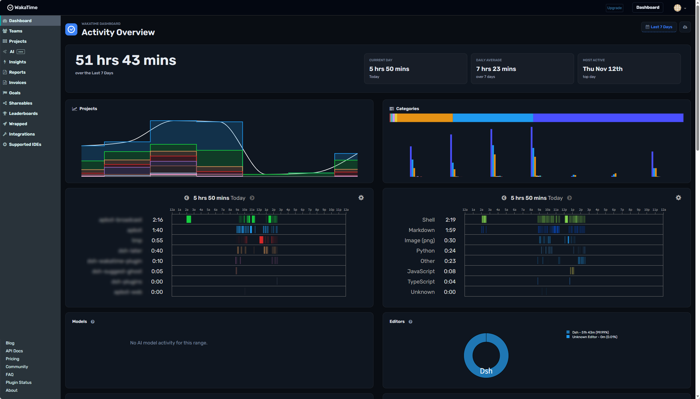

<p align="center">
  
</p>

# dsh-wakatime-plugin

[English](./README.md) | **简体中文**

**把在 DSH 里花的时间，记进你的 WakaTime 面板。**

> DeepSeek Harness 的 WakaTime 心跳插件：追踪 AI 辅助编码活动——每个工具调用、每次命令、每轮对话——按**项目 / 语言 / 类别**归集，并上报 AI token 用量。

> 本项目为社区集成，与 WakaTime 官方无隶属关系。

## 这是什么

DSH 里的活动原本不会出现在 WakaTime 上：WakaTime 靠编辑器插件上报，而你在 DSH 里的工作发生在终端和 AI 对话里。本插件补上这一段——它监听 DSH 的事件，转成 WakaTime 心跳发出去。

- 一条 `write` / `edit` → 一条带行数与语言的心跳
- 一条 `bash` 命令 → 一条按命令内容判定类别的 `app` 心跳
- 一轮 AI 回复 → 一条带 token 用量的 `ai coding` 心跳

不做的事：不改 DSH 核心、不打包宿主组件、不做本地存储以外的分析。

## 效果预览

装好之后的 WakaTime 面板：

<p align="center">
  
</p>

四个维度都由本插件喂数据：

| 面板区域 | 数据来源 |
|---|---|
| **Projects** | 每次心跳的 `project`：自动从 git / `package.json` / 目录名推断 |
| **Categories** | 工具调用映射（见[类别映射](#类别映射)）——`coding` / `browsing` / `researching` 等 |
| **Languages** | 按文件扩展名推断 |
| **Editors** | 由心跳的 `User-Agent`（`dsh/1.0.0 dsh-wakatime/1.0.0`）推出，所以"在 DSH 里干活"在面板上单独成了一类 |

## 安装

```bash
dsh plugin --profile web add dsh-wakatime-plugin
```

装完**重启 `dsh web`** 生效。然后到 **设置 → WakaTime** 填 API Key。

<details>
<summary>其他安装方式</summary>

从 GitHub 装：

```bash
dsh plugin --profile web add github:dsh-plugin-collection/dsh-wakatime-plugin
```

本地开发装（插件目录下）：

```bash
dsh plugin --profile web add /path/to/dsh-wakatime-plugin
```

从源码构建装：

```bash
cd dsh-wakatime-plugin && pnpm install && pnpm build
```

内部分发：本插件另在内部 Gitea 上以私有库分发，需要时向维护者索取仓库地址，建议固定 commit 安装：

```bash
dsh plugin --profile web add <内部仓库地址>#<commit-sha>
```
</details>

## 配置

全部设置都在 **设置 → WakaTime**，保存即生效，无需重启。

| 项 | 说明 |
|---|---|
| **API Key** | WakaTime API key（密码框展示）。留空时依次回退环境变量 `WAKATIME_API_KEY` → `~/.wakatime.cfg` → `cordis.patch.yml` |
| **API URL** | 服务地址，默认 `https://wakatime.com`；自托管 WakaTime 填自己的 |
| **代理地址** | `http://host:port`。留空依次回退 `HTTPS_PROXY` → `~/.wakatime.cfg` 的 `proxy`；填 `none` 强制直连 |
| **不走代理的地址** | 逗号分隔，留空沿用 `NO_PROXY`。如 `wakatime.com` 表示该域名直连 |
| **心跳间隔** | 60000–300000 ms |
| **项目名称 / 语言** | 留空自动识别，填了则覆盖 |
| **终端应用名** | 命令类心跳的 entity，默认 `Terminal`；可填 `DSH` 之类 |
| **追踪开关 ×3** | 工具调用 / 用户消息 / AI 消息 |
| **缓存** | 是否本地缓存 + 上限（10–1000 条） |
| **调试模式** | 打印更详细的日志 |

**API Key 优先级**：设置页 → `WAKATIME_API_KEY` 环境变量 → `cordis.patch.yml` → `~/.wakatime.cfg`。三层都只接受非空字符串，形状不对的会被忽略并回退，同时告警里说明。

## 验证

装完按这四步确认它在工作：

1. **看日志**——重启后应有 `loaded with API key waka_****xxxx`；
2. **让 DSH 做点事**——读一个文件、跑一条命令；
3. **等一个心跳周期**（默认 120 秒），日志出现发送成功；
4. **打开 WakaTime 面板**——今天的时间、项目、语言三项应出现对应记录。

如果第 3 步没动静，先看本地缓存：

```bash
wc -l ~/.dsh/wakatime/heartbeat-cache.jsonl
```

- `0` 行或文件不存在 = 一切正常（缓存只在失败时写入）；
- **持续增长** = 发送在失败，这时看日志里的 `上报失败…`。

## 兼容性

| 端 | 说明 |
|---|---|
| **DSH** | 支持范围见 `package.json` 的 `engines.dsh`；当前覆盖 `0.1.2` ~ `0.2.3` 各代（含预发布）。宿主启动时会校验，不匹配会禁用插件 |
| **Node** | ≥ 22.19（含 24+） |
| **平台** | Windows / macOS / Linux |
| **WakaTime** | 官方 wakatime.com，或任意 WakaTime 兼容自托管服务 |
| **其他遥测插件** | 每个 profile 只保留一个心跳后端，勿与 codetime 等同类插件同时启用 |

## 类别映射

| DSH 工具 | WakaTime 类别 | is_write |
|---|---|---|
| `write` / `edit` | `coding` | ✅ |
| `read` / `grep` / `glob` | `browsing` | — |
| `bash` / `pwsh` | **由命令内容判定**（见下） | — |
| `web_search` | `researching` | — |
| `mcp__codegraph__codegraph_explore` | `code reviewing` | — |
| `mcp__langfuse__*` | `debugging` | — |
| `subagent` / `subagent_fork` / `workflow` / `todo_write` | `coding` | — |
| `ask_user_question` / 用户消息 | `communicating` | — |
| AI 回复 | `ai coding` | — |
| `skill` | `learning` | — |
| 其他 | `coding` | — |

**shell 类别**不再一律记成 `building`——那是早期实现，用账号里 5290 条 shell 心跳复盘发现 98.7% 的"构建时间"其实不是构建。现在按命令本身判定：

| 命令 | 判为 |
|---|---|
| `ls` / `cat` / `grep` / `sed` / `head` … | `browsing` |
| `git` / `pnpm build` / `docker build` … | `coding` / `building` |
| `pnpm test` / `vitest` | `running tests` |
| 认不出来 | `coding` |

判定只看**裸子命令**，不看后续参数（`grep -n foo test/a.py` 里的 `test` 不会被当成跑测试），并且会先剥掉 `cd … &&`、`sudo`、`npx` 这类包装前缀。

## 已知限制

- **只追踪到文件与应用粒度相近的程度**——DSH 的工具调用没有细粒度的光标位置，WakaTime 上的行级明细不如 IDE 插件精确；
- **DSH 侧的 AI token 口径与 IDE 不同**：宿主给的是「未命中 + 缓存命中」两个互斥分量，插件分字段上报，不与 IDE 插件的数字直接可比；
- **历史数据不可回溯**：`entity` / `category` 的形态一旦改变，按这两个维度做跨版本对比会断裂；
- **读端点不可用**：WakaTime 自 2026-10 起对插件 key 封锁读端点（详见[开发](#开发)），因此插件无法回读自己的数据做校验。

## 开发

<details>
<summary>构建、测试与架构</summary>

```bash
pnpm install
pnpm build        # 清空 lib/ 后重建 host + client
pnpm typecheck
pnpm test         # vitest，169 个用例
```

```
src/
├── index.ts         # 插件入口：事件监听、定时器、配置迁移
├── config-value.ts  # volatile ref 解包与逐字段校验
├── wakatime.ts      # HTTP 客户端：代理、批量上报、逐条状态解析
├── tracker.ts       # 事件 → 心跳的转换与合并
├── cache.ts         # 本地 JSONL 缓存与按时间裁剪
├── project.ts       # git / package.json 项目名推断
├── category.ts      # shell 命令 → 类别判定
├── language.ts      # 扩展名 → 语言
├── diff.ts          # write/edit 行数计算
└── types.ts         # 类型与常量
```
</details>

<details>
<summary>批量上报契约：外层恒 2xx + 逐条状态码</summary>

`heartbeats.bulk` 的响应**外层永远 202**，真正的结果在 `responses` 数组的逐条状态码里。只判 `response.ok` 的实现会把整批被拒读成整批成功——被拒的心跳既不进缓存也不报错，是纯粹的数据丢失。

本插件的处理：

| 逐条状态 | 处理 |
|---|---|
| `2xx` | 已落库 |
| `4xx`（除 429） | 永久失败，丢弃并告警，带服务端原因 |
| `429` / `5xx` | 回缓存重试 |

字符串字段按服务端硬上限预先裁剪：`entity` ≤ 2083、`project` / `branch` ≤ 1024，空串同样被拒。被裁剪过的 `entity` 以 `...` 结尾。
</details>

<details>
<summary>缓存策略</summary>

- 只在**发送失败**时写入，成功即排空；
- 并发冲刷串行化，且只把**确实没落库**的心跳写回（早期版本会把已入库的也写回，导致重复上报）；
- 超过上限时**按时间**裁掉最旧的，并告警 `缓存超过上限（N 条），最旧的 M 条心跳已被丢弃（from → to）`——这条出现就是真的开始丢数据了。
</details>

<details>
<summary>AI token 口径</summary>

宿主的 `TokenUsage` 三个输入分量是**互斥**的：`inputTokens` 只是未命中部分，缓存命中单独记在 `cacheReadTokens`，计费输入 = 三者之和。

本插件把未命中报进 `ai_input_tokens`、缓存命中报进 `ai_cached_input_tokens`，**不把两者相加**；`cacheWriteTokens` 在 WakaTime 侧没有对应字段，不上报。

一个实测样本：某会话计费输入 80.1M，其中缓存命中 78.7M（98%+）。只报未命中的实现会让 WakaTime 的 Tokens 比本地面板小两个数量级。
</details>

<details>
<summary>版本闸门与 peer 写法</summary>

宿主 `dsh-app-boot` 的 `evaluatePluginCompatibility` 只读插件 `package.json`，规则：

| 条件 | 行为 |
|---|---|
| 有 `engines.dsh` | **只比较这一个区间**，`peerDependencies` 被忽略 |
| 没有 `engines.dsh` | 每个 `@deepseek-ai/dsh*` 前缀的 peer 都要被运行版本满足 |
| 比较方式 | `semver.satisfies(运行版本, 区间, { includePrerelease: true })` |
| 不通过 | 打印 `Plugin … is incompatible with dsh …` 并禁用该条目 |

**peer 要写区间枚举，不要写 `^` 前缀，更不要写精确版本。** 原因是 node-semver 默认语义（不带 `includePrerelease`）下，预发布区间只在比较器含有同一 `[major.minor.patch]` 元组锚点时才匹配：`^0.2.1-rc.2` 展开为 `>=0.2.1-rc.2 <0.3.0-0`，锚点只有 `0.2.1` 与 `0.3.0`，因此 `satisfies('0.2.2-rc.1', '^0.2.1-rc.2')` 为**假**——宿主升到 0.2.2-rc.1 后插件会被判成不兼容。显式写出 `>=0.2.2-alpha.2 <0.2.3-0` 才覆盖得住。

宿主 0.2.1 的一方包把 dsh peers 精确 pin 到同一版本（如 `@{deepseek-ai/dsh-agent}: "0.2.1-rc.2"`），插件照抄会在下一个 rc 上被整片禁用——本机日志里 `webhook-runtime` / `webhook-github` 两条就是这样消失的。

**补充 peer 枚举是持续动作**：补一项只吃得住的「该代 rc + 该代稳定版」，下一代仍需再补。
</details>

<details>
<summary>四个版本敏感的接线点（0.2.2 仍成立）</summary>

| 接线点 | 规则 |
|---|---|
| WebUI 槽位 `plugins.bundle.config` 的 key | 是**插件包名**，不是 settings 命名空间也不是 profile 条目 id；不匹配则没有配置卡片 |
| `@deepseek-ai/dsh-client-ui-primitives` | 必须保持 **external**，打进包会把整套图标复制一份 |
| 设置页自动投影 | 依赖 Config 上的 `.volatile()`，投影逻辑在宿主 `dsh-app-boot` |
| `.volatile()` 字段是 **ref 对象** | `apply()` 收到的是 `Object.freeze({ get })` 而非值。**必须解包**，否则 `api_url` 拼出非法 URL、`heartbeat_interval_ms` 被当成 1ms、布尔恒真、字符串字段整个不发、`cache_limit` 永不裁剪。本插件统一在 `src/config-value.ts` 处理 |
</details>

<details>
<summary>shell 类别判定实测</summary>

用账号里 5290 条 shell 心跳复盘：

| 类别 | 改动前 | 改动后 |
|---|---|---|
| `building` | 100.0% | 1.3% |
| `coding` | — | 50.6% |
| `browsing` | — | 46.4% |
| `researching` | — | 0.8% |
| `running tests` | — | 0.5% |
| `debugging` | — | 0.3% |

类别取值只用 WakaTime 权威集合（`wakatime-cli` 的 `pkg/heartbeat/category.go`）：表里既没有 `deployment` 也没有 `testing`（正确值是 `running tests`），自造词在面板上无法聚合。
</details>

<details>
<summary>命令心跳的 entity</summary>

`bash` / `pwsh` 心跳的 `type` 是 `app`。按 wakatime-cli 的定义（*"AppType represents an app entity"*），app 类型的 entity 应该是**应用名**而不是命令行。早期把整行命令当 entity，5281 条 shell 心跳散成 **5158 个不同 entity，98.2% 只出现过一次**——既无聚合价值，又随时可能撞上 2083 字符上限被逐条 400 拒收。

现在取设置项「终端应用名」（默认 `Terminal`），命令在做什么由 `category` 表达。5 秒窗口内的合并键是 `entity + category`，否则同一应用名下一条 `ls` 会覆盖掉 5 秒前的 `pnpm test`。

用户消息 / AI 回复类心跳**有意保留** `dsh-session-<id>` 作为 entity：基数由会话数决定（有界），且是唯一能按会话下钻的维度。
</details>

<details>
<summary>代理口径</summary>

出口代理按 **设置页 → 环境变量 → `~/.wakatime.cfg` → 直连** 的顺序取，先命中先赢。某一档不是合法 `http(s)` 地址时会被**忽略并告警**，然后继续回退。

启动时 debug 模式会打一行 `网络出口 经代理 http://…（来源：设置页）`，直接回答"现在走了哪条"。带账号密码的代理会被脱敏成 `***:***` 再打日志。

`NO_PROXY` / 「不走代理的地址」支持 `*`、精确主机与 `.suffix`（`example.com` 也匹配其子域）。

为什么插件必须读 cfg：实测同机上 curl 直连、curl 经代理、node 直连都 20/20 通，唯独插件间歇 `fetch failed`——因为它是同机上唯一不走代理的那条链路，而代理本来配在 `~/.wakatime.cfg` 里。
</details>

<details>
<summary>读端点 403：为什么不能再回读数据</summary>

WakaTime 自 2026-10 起对读端点（`/users/current`、`/users/current/projects`、`/users/current/heartbeats`）使用插件 key 返回：

```
403 API Keys are only for plugins, use your personal oauth token
```

而**写端点 `heartbeats.bulk` 仍接受插件 key**。这是上游策略变化，不是插件的鉴权 bug。

后果之一：设置页曾提供的「项目名称」候选下拉依赖 `/users/current/projects`，因此永远为空，已移除，项目名称改为自由输入。排查时也别把这次 403 误读成 key 失效——判断 key 是否可用要看写端点或失败告警。
</details>

<details>
<summary>排障</summary>

**插件没加载**：`lib/` 是否存在？`pnpm build`？日志里有没有 incompatibility 提示？

**设置页看不到卡片**：确认插件在 profile 的 bundles 里；完全重启 `dsh web`；看浏览器 console。

**心跳没发出去**，按这个顺序查（本插件曾因此静默断流一整周）：

1. **先看缓存，再看日志**——`~/.dsh/wakatime/heartbeat-cache.jsonl` 只在失败时写入。持续增长或长期顶在上限 = 发送在持续失败，越旧的心跳被挤掉越多，那段活动已不可恢复。
2. **读告警，不需要开 debug**——失败一律 warn 并带原因，且 **logger + console 双写**（本宿主的 `ctx.logger` 不进 stdout 捕获文件，只走 logger 等于没有日志，这是两次静默断流没人发现的直接原因）。关键告警：`上报失败…`、`缓存超过上限…已被丢弃`、`N/M 条心跳被逐条拒绝并已丢弃…`、`cache flush failed…`。
3. **升级宿主后先看有没有「配置字段不是可用值」告警**——volatile ref 当值用会以多种方式静默失效（见上文接线点）。
4. **确认 key 可用**——`未配置 WakaTime API Key` = 三层都没有可用值；`WakaTime API Key 无效` = 服务端 401；`上报失败…（cause: …）` = 传输层问题。诊断信息会带 `cause`（`ECONNRESET` / `ETIMEDOUT` / `ENOTFOUND`…），不再只有一句 `fetch failed`。
5. **怀疑「跑的不是你改的代码」时看构建指纹**——日志里 `apply called; artifact mtime=… pid=…` 直接回答这个进程载入了哪次构建。热重载可能留下旧 fiber 继续以旧代码发送，行为与代码不一致时先完全重启 DSH。
6. **载荷长度是硬校验**——仍出现「逐条拒绝」告警，说明有字段不在裁剪覆盖范围内，把告警里的服务端原因贴到 issue。
</details>

## 参考

- [WakaTime API 文档](https://wakatime.com/developers)
- [wakatime-cli](https://github.com/wakatime/wakatime-cli) —— 类别集合与字段语义的权威来源

## 许可

MIT © wujue
